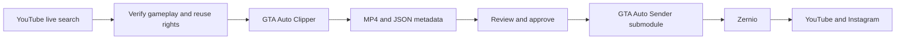

# GTA Live Clipping Toolkit

A local-first pipeline for finding GTA livestreams, creating vertical highlight clips, reviewing the results, and optionally scheduling approved clips to social platforms.


> Independent fan project. Not affiliated with Rockstar Games, Take-Two Interactive, YouTube, Instagram, or Meta.

## Overview

The toolkit connects two independently maintained components:

1. **GTA Auto Clipper** discovers live streams, captures gameplay, ranks moments, and renders 9:16 clips with captions and JSON metadata.
2. **GTA Auto Sender** is referenced as an upstream Git submodule. It feeds reviewed clips to Zernio for scheduled publishing.



Capture and publishing are separate steps. A clip is a local file until it passes review and the sender schedules it. The clipper does not silently publish.

## Features

- Searches YouTube Live for candidate gameplay streams using the YouTube Data API.
- Captures livestream chunks and scores moments with live chat, audio, and speech signals.
- Renders full-screen 9:16 clips with timed captions and a companion JSON file.
- Keeps source attribution and metadata with each clip to support review and downstream scheduling.
- Separates credentials, account configuration, queues, and generated media from tracked source files.

## Repository layout

```text
.
├── GTA-Auto-Clipper/            # Python clipper, publisher, tests, model attribution
│   ├── clip.py                  # Capture, moment ranking, rendering
│   ├── find_streams.py          # YouTube Live discovery
│   ├── live_chat.py             # Live-chat signal collection
│   ├── player_track.py          # Gameplay crop helpers
│   ├── tests/                   # Python unit tests
│   └── requirements.txt
├── GTA-Auto-Sender/             # Git submodule pointing to the upstream sender
├── LICENSES.md                 # Component licensing and attribution
├── .gitignore                  # Local secrets and generated files
└── .gitmodules
```

## Quick start

### 1. Clone the project

```powershell
git clone --recurse-submodules https://github.com/aviraj1805/GTA-AutoClipper-.git
cd GTA-AutoClipper-
```

If you cloned without `--recurse-submodules`, initialize the sender reference with `git submodule update --init --recursive`.

### 2. Install the clipper

Requirements include Python 3.10+, FFmpeg, and a JavaScript runtime for `yt-dlp`.

```powershell
cd GTA-Auto-Clipper
python -m venv .venv
.venv\Scripts\Activate.ps1
pip install -r requirements.txt
```

See [GTA-Auto-Clipper/README.md](GTA-Auto-Clipper/README.md) for supported options and platform details.

### 3. Configure YouTube search

Set the YouTube Data API key in your local shell environment; do not put it in source code or a prompt.

```powershell
$env:YOUTUBE_API_KEY = "YOUR_YOUTUBE_DATA_API_KEY"
python find_streams.py "GTA 6 gameplay" --max 25 --json
```

Search ordering is not a reliable live viewer count. Open a candidate and verify the actual video before recording. Confirm you have permission to reuse the creator's footage and preserve the creator credit.

### 4. Capture and review a clip

After verifying the live video shows GTA gameplay:

```powershell
python clip.py "https://www.youtube.com/watch?v=VIDEO_ID" `
  --gameplay-confirmed --moment-source combined --max-seconds 0 `
  --chunk 60 --top 1 --clip-len 28 --lead-in 6
```

Inspect the MP4 and matching JSON metadata before scheduling. For a local test file, use `--test`; test output is not publishable.

### 5. Configure optional scheduled publishing

Follow the upstream [GTA Auto Sender README](https://github.com/AnIntellectualBeing/GTA-Auto-Sender) after initializing the submodule. Keep the Zernio key in the local `.env` file and account IDs in `config/channels.json`. Start with the sender's dry-run commands. Install scheduled tasks only after reviewing the channel settings and test output.

## Tests

The clipper repository includes Python unit tests. From `GTA-Auto-Clipper/`, run:

```powershell
python -m unittest discover -s tests -p "test_*.py"
```

## Security and data handling

- Never commit YouTube or Zernio API keys, OAuth tokens, `.env` files, or real `config/channels.json` files.
- Local queues, captured streams, reviewed clips, generated output, and virtual environments are excluded by `.gitignore`.
- Verify source gameplay and reuse rights before capturing. Keep accurate creator credit and review every clip before publishing.
- Treat API quotas and platform posting limits as operational constraints; avoid replaying failed uploads automatically without checking the failure reason.

## Scope and limitations

- Stream discovery depends on YouTube API availability, quota, and the current live search results.
- Livestream playback and caption quality depend on source availability and audio conditions.
- The sender is an upstream submodule, so its code and release history remain maintained by its original repository owner.
- This repository does not include paid guide PDFs or paid prompt packs, private account setup, stream recordings, or generated clips.

## Licensing

See [LICENSES.md](LICENSES.md) for component-level licenses and attribution. This combined repository does not relicense the sender submodule.
